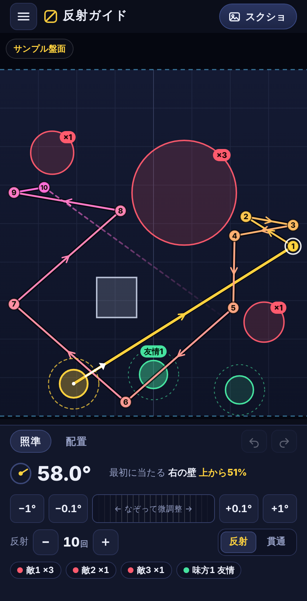

# 反射ガイド for モンスト

モンストのバトル画面のスクショに自キャラ・敵・ブロック・味方を置いて、**何回先までも反射する線**を見られるガイドです。アイテムの「ガイド」は壁1回分の反射しか見えませんが、これは10回でも40回でも先まで表示します。



- iPhone 15 Pro Max（Safari / ホーム画面のアプリ）向けに作っています。ほかのスマホやパソコンのブラウザでも動きます。
- スクショを読み込むと、**盤面の位置を自動で合わせ**、「1st」「2nd」などのラベルから**キャラの位置も自動で見つけます**。
- 反射タイプ／貫通タイプ、敵ごとの「跳ね返る／すり抜け」、ブロック（アンチブロック対応）、味方に触れたか（友情が出るか）に対応しています。
- 一度開けば電波がなくても使えます。保存したデータは端末の中にだけ残ります。

> 個人が作った非公式のツールです。モンスターストライクの運営とは関係ありません。ゲームのデータには触れず、スクショを見て計算しているだけです。

## iPhone での使い方

### 1. 開く・ホーム画面に追加する

公開URL（GitHub Pages を有効にした後）: `https://ksm2102077-prog.github.io/abc2107/`

Safari で開き、共有ボタン（□に↑）→「ホーム画面に追加」。アイコンから全画面で起動できます。

### 2. 毎ターンの流れ

1. **スクショを撮る**: モンストのバトル画面でサイドボタン＋音量を上げるボタン。
   「設定 → アクセシビリティ → タッチ → 背面タップ」にスクショを割り当てると、iPhone の背中を2回たたくだけで撮れて便利です。
2. **読み込む**: 右上の「スクショ」→ 写真を選ぶ。盤面の位置は自動で合います。キャラが見つかったら、自分の番のキャラの番号をタップ（残りは味方になります）。
3. **配置する**（最初の1回だけ。同じステージなら次のターンも残ります）: 「配置」タブで「＋敵」「＋ブロック」。敵の円は白い丸をドラッグして見た目の大きさに合わせます。2本指で拡大できます。
4. **狙う**: 「照準」タブで盤面を引っ張ると線が出ます（モンストと同じく、引いた方向の反対へ飛びます）。細かい角度は「±0.1°」ボタンか、真ん中のバーを左右になぞります。角度の数字をタップすると直接入力もできます。
5. **モンストで打つ**: パネルに出る「最初に当たる 右の壁 上から38%」のような目印に、ゲームの矢印を向けて打ちます。

### 画面の見かた

| 表示 | 意味 |
| --- | --- |
| 金色の実線の円 | 自キャラの当たり判定（線の計算に使う大きさ） |
| 金色の点線の円 | 自キャラの見た目の大きさ。スクショのキャラに合わせる目安 |
| 赤い円 | 敵。点線はすり抜ける敵、「×3」はこの軌道で当たる回数 |
| 灰色の四角 | ブロック（アンチブロックの時は点線） |
| 緑の円 | 味方。線が触れると「友情」と表示 |
| 線の番号 | 何回目の反射か。白い輪が1回目 |
| 点線の続き | 設定した反射回数の先（次に当たるところまで） |

## 当たり判定と盤面の大きさ（調べた結果）

実機のスクショ（Android 1080×2340 と 1080×1920 の計15枚）で測った値を使っています。iPhone 15 Pro Max（1290×2796）とほぼ同じ縦横比の端末です。詳しくは [docs/RESEARCH.md](docs/RESEARCH.md)。

- **左右の壁は画面の端**。
- **盤面の縦横比は 8:9**。下の壁は黄色いパネル（HPゲージの枠）の上端のすぐ上で、上の壁はそこから横幅の1.125倍上（ボスのHPゲージのあたり）。2016年にプロ選手が出題した「ステージの横縦比は8:9」とも一致しました。
- **自キャラの当たり判定は半径＝盤面の横幅の約4.55%**。見た目の円（約8.2%）よりかなり小さいです。
- 敵の判定は円として扱います（攻略界隈で広く言われている説）。ボスによっては見た目と判定がずれていることがあるので、そこは円の大きさで調整してください。
- 弱点の出っ張りや、当たった敵が少し下がる「ヒットバック」は再現していません。正面からの当たりでずれることがあります。

自キャラの判定の大きさは「設定」で変えられます（ふだんは変えなくて大丈夫です）。

## GitHub Pages で公開する手順

このリポジトリは公開設定なので、無料で公開できます（URLを知っている人は誰でも開ける状態になります）。

1. パソコンかスマホのブラウザで GitHub のこのリポジトリを開く
2. **Settings** → 左のメニューの **Pages**
3. **Build and deployment** の **Source** を「Deploy from a branch」にする
4. **Branch** で公開したいブランチ（`main` に取り込んだ後なら `main`）と `/ (root)` を選んで **Save**
5. 1〜2分待つと `https://ksm2102077-prog.github.io/abc2107/` で開けるようになります

更新したときは `sw.js` の `CACHE` の番号を上げると、ホーム画面のアプリにも新しい版が届きます。

## 開発者向け

ビルド不要の素の HTML/CSS/JavaScript です。

```
index.html            画面の骨組み
css/app.css           見た目
js/physics.js         軌道の計算（壁・敵の円・ブロック・味方）
js/detect.js          スクショから盤面とキャラの位置を見つける
js/store.js           端末内への保存（IndexedDB）
js/app.js             描画とタッチ操作
sw.js                 オフライン用
tools/                アイコン・テスト画像・1ファイル版の生成
tests/                自動テスト
```

```
npm test              # 軌道計算とスクショ検出の単体テスト（Node.js 18 以上）
npm run e2e           # ブラウザでの通しテスト（Playwright と Chromium が必要）
npm run build:artifact  # 1つの HTML にまとめた版を dist/ に出力
```

テスト用のスクショは、実機と同じ位置関係で描いた合成画像です（ゲームの画像はリポジトリに含めていません）。
